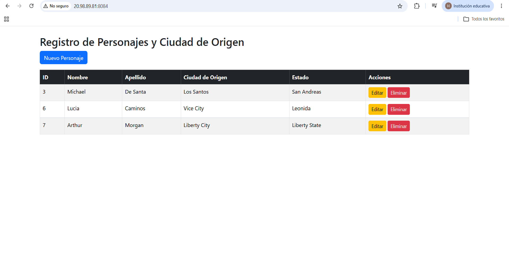

#  Actividad 3: CRUD Spring Boot con JPA, Thymeleaf y VPS en Azure

Proyecto de gestión para personajes y ciudades del universo GTA. La aplicación implementa un CRUD completo con arquitectura en capas, base de datos relacional MySQL y despliegue en servidor VPS Ubuntu en Microsoft Azure.

---

## 🛠️ Tecnologías Utilizadas

* **Lenguaje:** Java 21 (OpenJDK)
* **Framework:** Spring Boot 3 (Spring Data JPA, Spring Web, Thymeleaf)
* **Base de Datos:** MySQL Server 8.0
* **Frontend:** Thymeleaf + Bootstrap 5
* **Infraestructura:** VPS Azure (Ubuntu 24.04 LTS con SWAP de 2GB)
* **Gestor de Dependencias:** Apache Maven

---

## 🗄️ Modelo de Datos y Entidades

Se crearon dos entidades relacionales basadas en el universo GTA:

1. **`Persona`**: Representa a los personajes (ej. Niko Bellic, Michael De Santa, Trevor Philips).
2. **`CiudadOrigen`**: Representa las ciudades emblemáticas (ej. Liberty City, Los Santos, Vice City).

* **Relación:** `@ManyToOne` (Una `Persona` pertenece a una `CiudadOrigen`) y `@OneToMany` bidireccional desde la entidad origen.

---

## 📸 Evidencias de Funcionamiento (CRUD & Despliegue)

### 1. Entidades Relacionadas y Lectura de Datos (READ)
Se muestra la lista principal con los datos cargados desde MySQL en Azure, reflejando el nombre y estado de la ciudad de origen en lugar de solo su ID.

### 2. Formulario de Registro / Edición (CREATE / UPDATE)
Formulario interactivo con despliegue dinámica de las ciudades registradas.

### 3. Registro Actualizado (CREATE exitoso)
Confirmación del registro del nuevo personaje (Arthur Morgan) en la lista.

### 4. Eliminación de Registros (DELETE)
Demostración del funcionamiento de la eliminación de datos.

---

## 🚀 Despliegue y Ejecución

* **Puerto de ejecución:** `8084`
* **Enlace público (VPS Azure):** [http://20.98.89.81:8084](http://20.98.89.81:8084)
* **Repositorio oficial:** [https://github.com/Hasielisaimendozalucero/HIMLact3_t4](https://github.com/Hasielisaimendozalucero/HIMLact3_t4)
